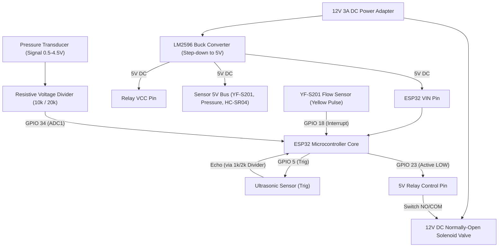

# IoT Hardware Circuit Diagram & Wiring Specification

This document provides the complete hardware wiring diagram, pinout table, and power delivery architecture for the ESP32 Smart Water Monitoring & Leakage Isolation Node.

---

## 1. System Pinout Table

| Peripheral | Component | ESP32 Pin | Signal Type | Electrical Levels |
| :--- | :--- | :--- | :--- | :--- |
| **Flow Sensor** | YF-S201 Hall Flow Meter | `GPIO 18` | Digital Input (Interrupt) | 5V VCC, 3.3V Signal (Pull-up) |
| **Pressure Transducer**| 0-1.2 MPa Piezoresistive | `GPIO 34` | Analog Input (ADC1_CH6) | 5V VCC, 0.5-4.5V (via divider) |
| **Ultrasonic Sensor** | JSN-SR04T / HC-SR04 | `GPIO 5` (Trig) / `GPIO 19` (Echo) | Digital I/O | 5V VCC, 3.3V Echo (via divider) |
| **Solenoid Relay** | 1-Channel 5V Relay | `GPIO 23` | Digital Output (Active LOW) | 5V Coil, 3.3V Logic |
| **Status LED** | Onboard Blue LED | `GPIO 2` | Digital Output | 3.3V Logic |
| **Power Supply** | LM2596 Buck Converter | `VIN / GND` | Power Input | 12V DC in -> 5V DC out |

---

## 2. Electrical Wiring Schematic (Mermaid)

---

## 3. Voltage Divider Circuits for 5V Sensor Interfacing

The ESP32 GPIO inputs cannot exceed **3.3V**. For sensors operating on 5V logic/analog output, voltage dividers are used:

### A. Pressure Sensor Signal (0.5V to 4.5V)
$$V_{out} = V_{in} \times \frac{R_2}{R_1 + R_2}$$
- $R_1 = 10\text{ k}\Omega$
- $R_2 = 20\text{ k}\Omega$
- Maximum Voltage: $4.5\text{V} \times \frac{20}{30} = 3.0\text{V}$ (Safe for ESP32 ADC)

### B. Ultrasonic Echo Pin (5V Digital)
- $R_1 = 1\text{ k}\Omega$
- $R_2 = 2\text{ k}\Omega$
- Maximum Voltage: $5.0\text{V} \times \frac{2}{3} = 3.33\text{V}$ (Safe for ESP32 digital GPIO)

---

## 4. Bill of Materials (BOM)

1. **Microcontroller:** ESP32 DevKit V1 (30 or 38 pin)
2. **Water Flow Meter:** YF-S201 1/2" inline turbine flow sensor (1-30 LPM)
3. **Pressure Transmitter:** 0-1.2 MPa (0-174 PSI) G1/4" threaded stainless transducer
4. **Water Level Sensor:** JSN-SR04T integrated waterproof ultrasonic probe
5. **Relay Module:** 5V single-channel relay with optocoupler isolation
6. **Actuator:** 12V DC 1/2" Brass Solenoid Valve (Normally Open / Closed)
7. **Power Supply:** 12V 3A AC/DC switching adapter + LM2596 DC-DC buck converter
8. **Resistors:** $1\text{ k}\Omega, 2\text{ k}\Omega, 10\text{ k}\Omega, 20\text{ k}\Omega$ (1/4W 1% metal film)
